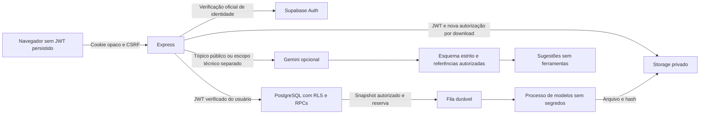

# Modelo de ameaças — Norte

Data: 12/10/2026. Escopo: Express na mesma origem, Supabase Auth/PostgreSQL/Storage, geração por modelos locais, ajuda Gemini opcional e sugestões técnicas somente para escopo público autorizado. Uploads, importação de fontes e processamento de dados restritos permanecem fechados.

## Caminho dos dados e fronteiras

Senhas passam ao SDK Auth e não são armazenadas pela Norte. A sessão do navegador é aleatória, de 32 bytes, guardada como hash no banco; tokens Auth ficam cifrados com AES-256-GCM e chave do ambiente. Não há JWT em localStorage. A chave administrativa fica no servidor, restrita a sessões, limites, auditoria, pedidos calculados e processamento interno. Consultas normais usam cliente novo com JWT do usuário.

Cookies são HttpOnly, Secure em produção, SameSite=Strict e prefixo `__Host-`. CSRF usa biblioteca mantida, segredo, semente assinada e origem exata configurada, inclusive login. Host/Forwarded não escolhem URLs. A sessão tem teto de sete dias; logout elimina o registro BFF; recuperação revoga todas as sessões BFF. O estado da conta e a autorização são revalidados nas operações. Um JWT Supabase já emitido tem sua própria validade: revogar a sessão BFF não é alegação de revogação instantânea daquele token fora do BFF.

## Papéis

| Ator | Escopo autorizado |
| --- | --- |
| Visitante | Aurora público, catálogo aprovado, FAQ e cotação validada; sem projeto compartilhado editável |
| Proprietário | Projetos próprios, limites do plano, versões, arquivos e concessões explícitas |
| Outro usuário | Nenhum conteúdo daquele projeto por adivinhar ID, path ou chave de tarefa |
| Revisor | Leitura do projeto concedido, com escopo e vencimento; não pode editar o projeto nem registrar análises em nome do proprietário |
| Administrador comercial | Configuração comercial, pedidos e feedback; MFA recente; sem acesso técnico automático |
| Administrador técnico | Controles operacionais, catálogo e alertas; MFA recente; acesso técnico só mediante concessão do proprietário |
| Worker | Snapshot reservado e tarefas internas delimitadas; revalida projeto/conta/controles antes de publicar o resultado |

O cargo reside em `norte_private.admins`, nunca em metadados editáveis de perfil. API e SQL exigem AAL2/TOTP recente (dez minutos) para administração.

## Ameaças e controles efetivos

| Ameaça | Controle no código/banco | Limite residual |
| --- | --- | --- |
| IDOR entre projetos, incluindo arquivo parcial | RLS, propriedade/concessão atual, FK composta, grants mínimos; GET/HEAD/Range reautorizados; `no-store` | Contrato local testado; homologação do serviço hospedado pendente |
| Escrita direta que contorna plano ou muda dono | Sem grants diretos de alteração; RPCs com `search_path=''`, identidade, locks e versão esperada | DBA/chave administrativa continuam privilegiados e exigem operação protegida |
| IA manipulada propõe SQL, shell, outro projeto, preço ou aprovação | Nenhum executor de ferramentas; JSON estrito; IDs/versões/cláusulas/trechos autorizados; sugestões separadas, sem aplicação automática | Citação válida não prova conclusão correta; revisão técnica permanece necessária |
| Exfiltração pela ajuda | Cliente envia somente enum de tópico; servidor reconstrói FAQ pública; saída do modelo escolhe resposta local aprovada | Texto digitado permanece na tela; não se promete detectar todo dado sensível |
| Contexto técnico indevido | Provedor/chave separados, padrão `none`, classificação pública e autorização explícita, fontes adotadas/licenciadas/permitidas | Sem processamento externo de projetos privados/restritos nesta versão |
| XSS ou rastreamento | Escape contextual/textContent; CSP sem script inline/eval, sem frames/objetos; respostas IA sem HTML, links ou imagens remotas | Estilos inline legados permanecem permitidos; não conferem execução de scripts |
| PDF ativo ou upload malicioso | Upload/importação indisponíveis; PDF.js local com canvas, sem camadas de scripts, formulários, anexos ou links; limites de página/canvas | Leitor não substitui scanner; novos originais dependem de ingestão controlada |
| SSRF/rebinding | Lista exata de HTTPS/host/path, IP público IPv4/IPv6, DNS fixado na conexão, revalidação de cada redirect, tempo/tamanho/tipo | Importador não está liberado operacionalmente |
| Execução/egress na geração | PDFKit/DOCX recebem texto, não HTML/templates do usuário; filho sem segredos, Node Permission Model, sem escrita/processos/addons e chamadas de rede recusadas | Bloqueio de rede do filho é em código; não é sandbox de SO para parser de arquivos arbitrários |
| Corrida, repetição, custo e falha | Locks transacionais, cotas por conta, idempotência, reserva/reembolso único, lease e tentativas limitadas; armazenamento global/conta | Limites de chamadas/tokens não são teto monetário do provedor; configurar orçamento externo |
| Preço adulterado/confirmação de outra versão | Centavos no servidor, cotação assinada ligada à seleção/ator/validade, nova verificação de elegibilidade e versão; pedido não ativa plano | Disponibilidade humana e cobrança exigem confirmação operacional real |
| Vazamento em logs/backup | Erros públicos genéricos e request ID, auditoria sem texto técnico, backup cifrado separado, sessões/MFA excluídos do backup | Logs de acesso/retensão dos provedores e restauração Auth real precisam de homologação |

A varredura de frases suspeitas opera em cópia e só suspende aquela análise externa. Termos técnicos como comando, sistema e instrução não são bloqueios genéricos. O requisito original permanece editável, exportável e inalterado. Sem busca vetorial ou embeddings; nenhum índice global privado foi criado.

## ASVS utilizado como referência

Versão estável consultada: [OWASP ASVS 5.0.0](https://github.com/OWASP/ASVS/tree/v5.0.0/5.0/en). Foco inicial em controles aplicáveis de níveis 1 e 2; isto é um mapeamento de trabalho, não declaração de atendimento integral a L2.

| Identificadores da versão 5.0.0 | Aplicação na Norte |
| --- | --- |
| V1.2.1, V1.2.2 | Escape de conteúdo e URLs construídas de identificadores validados |
| V3.4.1, V3.4.2, V3.5.1 | HSTS, origem controlada e token CSRF |
| V7.2.1, V7.4.1 | Verificação no backend e invalidação da sessão BFF |
| V8.2.1, V8.3.1 | Permissões por função e autorização na API/banco |
| V5.2.1, V5.3.1 | Tamanhos limitados, arquivos sem execução; uploads fechados |
| V16.2.1, V16.4.1 | Metadados de auditoria e campos controlados, sem concatenação de conteúdo em logs |

A proteção CSV também considera V1.2.10 (nível 3), sem ampliar a alegação de cobertura geral. Identificadores foram conferidos nos capítulos oficiais, não reutilizados da numeração do ASVS 4.

Referências de decisão: [OWASP Prompt Injection](https://cheatsheetseries.owasp.org/cheatsheets/LLM_Prompt_Injection_Prevention_Cheat_Sheet.html), [autorização](https://cheatsheetseries.owasp.org/cheatsheets/Authorization_Cheat_Sheet.html), [RAG](https://cheatsheetseries.owasp.org/cheatsheets/RAG_Security_Cheat_Sheet.html), [SSRF](https://cheatsheetseries.owasp.org/cheatsheets/Server_Side_Request_Forgery_Prevention_Cheat_Sheet.html), [arquivos](https://cheatsheetseries.owasp.org/cheatsheets/File_Upload_Cheat_Sheet.html) e [saídas estruturadas e limites de proteção](https://developers.openai.com/api/docs/guides/agent-builder-safety). A Norte não integra OpenAI nem um agente genérico; a última fonte foi consultada como orientação conceitual solicitada.

Detalhes da identidade e dos arquivos: [Supabase RLS](https://supabase.com/docs/guides/database/postgres/row-level-security), [chaves](https://supabase.com/docs/guides/getting-started/api-keys), [sessões no servidor](https://supabase.com/docs/guides/auth/server-side/advanced-guide) e [Storage](https://supabase.com/docs/guides/storage/security/access-control). O proxy permanece não confiável até verificar a topologia real do Render; isso pode agregar limites de IP, mas não aceita IP forjado para contorná-los.

## Configuração e publicação

A automação operacional é restrita aos IDs do Supabase e Render de testes_requisitos, confere repositório, branch, diretório e plano antes de qualquer escrita. Não lista nem altera o protótipo anterior norte. Tokens de gestão ficam apenas no `.env` operacional; o web service recebe somente suas credenciais de execução. A chave exposta na conversa é substituída e revogada após verificação da publicação. O executor de migração valida CA e hostname e não entrega parâmetros da URI capazes de sobrepor a configuração TLS ao driver.

Limitação observada por API: sem SMTP próprio, o Supabase Free recusa templates customizados. A aplicação não anuncia confirmação enviada quando o provedor falha e não permite que ausência de SMTP desative a confirmação de identidade. A chave gerada automaticamente pelo Render mantém 256 bits e é decodificada de forma canônica.
